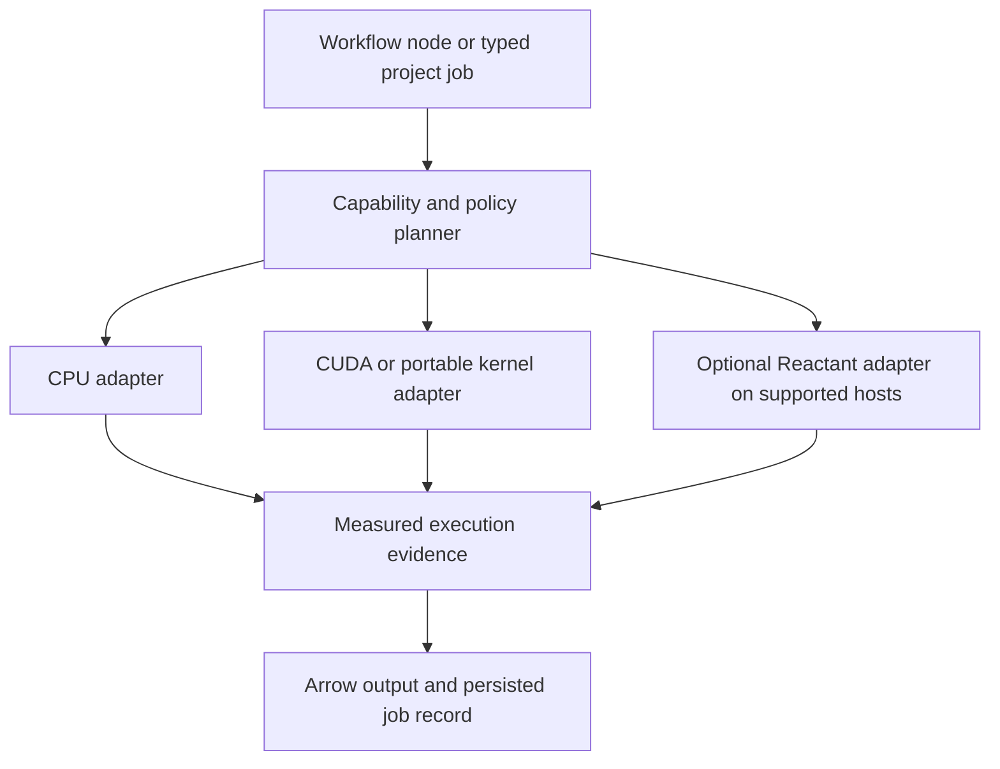

# GPU runtime assessment and integration design

Assessment date: 2026-09-20. This is a source review, focused diagnostic record, and proposed design; it does not close a delivery or readiness gate.

## Decision

JuliaFlow already has the beginnings of a GPU execution layer, but it does not automatically convert arbitrary Julia packages into GPU implementations. Its current useful GPU computation is narrow: a CUDA affine operation, a KernelAbstractions smoke kernel, and CUDA reductions for selected tuning validation metrics. Model fitting remains on the CPU in the inspected paths.

The normal compiled-module CUDA smoke passed on this host during the assessment. This establishes one real kernel on one GPU, not package-wide acceleration, worker device-selection correctness, or model training. A separate diagnostic with compiled modules disabled failed, and both modes emitted a toolkit-version warning.

Julia already supplies the compiler, array, kernel, and scheduling building blocks needed for a better layer. Reactant.jl is particularly relevant to compilation of supported numerical Julia programs. Therefore the request's condition that no suitable Julia tooling exists is not met. Developing a replacement compiler from scratch is not justified. The missing product work is capability-aware dispatch and tested workload adapters over those existing tools.

A supported-workload runtime is feasible. A promise that every CPU package will run correctly and efficiently on the GPU is not.

## Scope and provenance

- Inspected checkout: `efe6d32b73d0beb1d0e7179cc9a7c7e6a32802df`, branch `codex/aks-36-datascienceproject-substrate`.
- BRD: `business-requirements-v0.3.0.md` is actually version **0.4.1** inside its document control section. Sections 5.6 and 9 specify supported local GPU use, explicit CPU fallback, and CUDA.jl/KernelAbstractions.jl.
- Read the GPU scope and evidence in `Plan.md`, `docs/TODO.md`, `docs/risk-register.md`, and `docs/brd-traceability.md` against executable source.
- Live GitHub readback: [PR #40](https://github.com/Gravelaw/LowcodeMLtoolkit.jl/pull/40) remains OPEN; its remote head is `a70ea67eda343655f70fe336c294f8ec9e638889`, different from the inspected local revision. Findings here concern the current checkout, not every open branch or the remote head.
- Live Linear readback: [AKS-36](https://linear.app/gravelaw/issue/AKS-36), [AKS-43](https://linear.app/gravelaw/issue/AKS-43), and [AKS-56](https://linear.app/gravelaw/issue/AKS-56) are In Progress. AKS-43 owns typed job/resource evidence, not a universal GPU translator. AKS-56 is already addressing resource-evidence contract consistency.
- Proposed runtime implementation and newly identified GPU defects remain untracked findings in this assessment. No new issue, status transition, commit, push, or PR was made.
- Pre-existing `AGENTS.md` modifications and `docs/images/` were preserved. This report is the only authored repository change.
- Julia routing receipt: catalog `2.1.0`, digest `996753585e98ac66877932c1569ee2301c9a19cd3e763a3a34860498c837fc6e`, route `b6cc43e6-8933-47de-b028-8f3033074217`, selected `julia-plan-project-work`.

## What the repository actually implements

| Surface | Source | Observed behavior |
| --- | --- | --- |
| GPU dependencies | `Project.toml:9`, `Project.toml:14` | CUDA major 5 and KernelAbstractions 0.9 are direct dependencies. Julia compatibility starts at 1.10. Local package sources report CUDA 5.11.3 and KernelAbstractions 0.9.41. |
| Workflow placement | `services/execution-service/src/JuliaFlowExecutionService.jl:1083` | `gpu_preferred` and `gpu_required` select a GPU resource lane. This is scheduling intent, not code translation or proof that a model ran on a GPU. |
| Device inventory | `services/worker-service/src/JuliaFlowWorkerService.jl:677` | Parses `JULIAFLOW_GPU_REGISTRY`, defaults to `mock:nvidia0`, assigns 16 GB per entry, and treats non-mock tokens as hardware. It does not enumerate CUDA hardware here. |
| Worker computation | `services/worker-service/src/JuliaFlowWorkerService.jl:823` | Selects the first GPU node and a small fixed workload switch. The default is `mock_vector_sum`; supported cases also include CPU mock matrix energy and CUDA vector affine. It is not a general package/node execution adapter. |
| Real CUDA operation | `services/worker-service/src/JuliaFlowWorkerService.jl:856` | Checks CUDA functionality and devices, transfers a vector to `CuArray`, computes `2x + 1`, synchronizes, and copies the result back. KA is used to identify the backend; the actual worker operation is CUDA array broadcast. |
| Hardware profile | `services/api-gateway/src/JuliaFlowApiGateway.jl:877` | GPU counts and VRAM derive from the configured registry. CUDA status derives from selection and a smoke environment flag; these fields are not a successful kernel probe. |
| Typed job resource evidence | `services/api-gateway/src/JuliaFlowDataScienceProjectJobs.jl:20` | Selected backend and dispatch lane derive from user settings and registry counts. These describe requested placement, not measured execution of every stage. |
| Tuning metrics | `services/api-gateway/src/JuliaFlowDataScienceProjectTuning.jl:313` | Genuine CUDA availability checks and GPU MAE/MSE/RMSE/accuracy reductions, with failure evidence and CPU metric fallback. Scope is explicitly `validation_metric_acceleration`; fit backend is explicitly `local_cpu`. |
| MLJ training | `services/api-gateway/src/JuliaFlowDataScienceProjectMLJ.jl:258` | Builds a host DataFrame and collected target, loads MLJLinearModels, and invokes `MLJ.fit!`. There is no GPU model or array adaptation in this path. |
| GPU helper node | `extensions/base/src/nodes/TierOneTableNodes.jl:4043` | Adds an eligibility flag using configured available/required memory. It neither probes hardware nor offloads the table processing. |
| Hardware smoke | `scripts/smoke-cuda-kernel.jl:24` | A real KA affine kernel, enabled with `JULIAFLOW_CUDA_SMOKE=1`. |

The control documents correctly distinguish earlier mock/CPU-fallback milestones from compatible-hardware GPU proof. Their completed checkboxes should not be read as broad GPU acceleration of MLJ, DataFrames, or the full node catalog.

## Gaps confirmed by source and focused probes

1. **Execution evidence can overstate GPU use.** `gpu_runtime_metadata` chooses `gpu_execution_path` from registry placement, while `execute_gpu_workload` can execute a CPU mock. A focused Julia probe produced all three results below, each calculating the same host-side sum:

   ```text
   registry=mock:nvidia0           path=gpu          workload=mock_vector_sum sum=10.0
   registry=cuda:unverified-device path=gpu          workload=mock_vector_sum sum=10.0
   registry=<empty>                path=cpu_fallback workload=mock_vector_sum sum=10.0
   ```

   Existing worker tests also assert `gpu` for the mock result. Simulation remains useful for tests, but cannot establish hardware execution in release/local-appliance mode.

2. **Device selection is not bound to execution.** The worker records the registry-selected device, but its CUDA function receives only the vector, enumerates devices, and operates on the current CUDA device. No corresponding `CUDA.device!` selection was found in these execution paths. Recorded selection and the actual device can therefore diverge.

3. **Strict GPU policy is incomplete.** `gpuPreference` values are validated and stored, but searches found no execution-time enforcement of `cuda_required`. Both GPU execution hints select the GPU lane; empty-registry placement can still fall back. Required-GPU requests need explicit rejection when capability, hardware, or memory requirements cannot be met.

4. **Real-kernel fallback is incomplete in the worker.** `gpu_runtime_metadata` invokes the workload before deriving its CPU fallback path. The CUDA workload throws on unavailable CUDA, and `process_gpu_compute_tick!` has no local fallback or failure transition around that call. The successful mock fallback does not establish real-workload fallback. The tuning helper has a better bounded fallback pattern.

5. **There is no common capability registry.** No per-operation contract says which package/model/backend/dtype/shape combinations are supported, how much VRAM is needed, or whether CPU retry is safe. No Reactant, Dagger, Flux/Lux, or AcceleratedKernels integration was found in the inspected application source or direct dependencies.

6. **Multi-GPU smoke is weaker than its name suggests.** `JULIAFLOW_REQUIRE_MULTI_GPU=1` checks that at least two devices are visible; the script then launches on the current device only. This is not proof of correct execution and isolation on both devices.

7. **Current metric acceleration has avoidable overhead.** The tuning loop first computes the CPU metric, then copies target/prediction arrays to the GPU for each supported metric. It does not retain GPU inputs across metrics or use a measured offload threshold. A GPU being available does not establish a speedup for this workload.

## Existing Julia tools worth using

| Tool | Useful role | Boundary |
| --- | --- | --- |
| [CUDA.jl](https://cuda.juliagpu.org/stable/usage/workflow/) | Run compatible array operations on `CuArray`; use CUDA libraries and custom kernels. Already in JuliaFlow. | Generic array code often ports well; concrete CPU arrays, unsupported operations, and scalar host loops still need adaptation. Disable scalar indexing when validating GPU paths. |
| [KernelAbstractions.jl](https://juliagpu.github.io/KernelAbstractions.jl/stable/) | Write one explicit parallel kernel against CPU/GPU backend interfaces. Already in JuliaFlow. | Portability applies to the kernel; it does not automatically parallelize arbitrary package internals. |
| [AcceleratedKernels.jl](https://juliagpu.github.io/AcceleratedKernels.jl/stable/) | Reuse map, reduction, sorting, accumulation, search, and parallel-loop building blocks. | Requires compatible data, operations, and call sites. Good candidate for numerical preprocessing adapters. |
| [Adapt.jl](https://github.com/JuliaGPU/Adapt.jl) | Convert nested data structures and array wrappers to device-compatible storage. | Moves/adapts data structure representation; it does not rewrite algorithms. |
| [Reactant.jl](https://enzymead.github.io/Reactant.jl/stable/introduction/) | Trace supported Julia numerical functions into MLIR/XLA programs targeting accelerators. Closest match here to a compilation layer. | Compatibility must be checked per function and input structure. Traced control flow and scalar constants have specific semantics; arbitrary I/O/package entry points cannot be assumed portable. |
| [Dagger.jl](https://juliaparallel.org/Dagger.jl/stable/gpu/) | Schedule compatible kernels/array operations across devices and manage data dependencies. | Helps placement and orchestration; the workload must already be GPU-compatible. Adopt only if the existing worker architecture needs its scheduling capabilities. |
| [Flux.jl](https://fluxml.ai/Flux.jl/stable/guide/gpu/) | Existing GPU support for supported neural-network model/data paths. | A model-family integration, not an automatic accelerator for MLJLinearModels or arbitrary MLJ models. |
| [GPUCompiler.jl](https://github.com/JuliaGPU/GPUCompiler.jl) | Compiler infrastructure underneath Julia GPU backends. | Its documentation explicitly directs end users to packages built on it. JuliaFlow does not need to implement a new compiler backend. |

[JuliaGPU](https://juliagpu.org/) also supplies AMDGPU.jl, oneAPI.jl, and Metal.jl for other vendor/platform combinations. Those are possible later backends, not current JuliaFlow support claims.

[MLJ's acceleration interface](https://juliaai.github.io/MLJ.jl/stable/acceleration_and_parallelism/) supports computational resources, with CPU threads/processes as documented examples. Selecting an MLJ resource is not evidence that every wrapped model has a GPU implementation.

Reactant deserves a separate Linux prototype: its [current configuration documentation](https://enzymead.github.io/Reactant.jl/stable/introduction/configuration) lists Linux/macOS host support and NVIDIA GPU acceleration on Linux. It is not a documented native-Windows drop-in for this checkout. Its [control-flow documentation](https://enzymead.github.io/Reactant.jl/stable/tutorials/control-flow) and [scalar-tracking FAQ](https://enzymead.github.io/Reactant.jl/stable/introduction/FAQs) must be part of compatibility validation. The upstream Project.toml currently permits Julia 1.10+, but dependency resolution against JuliaFlow was not attempted.

The NVIDIA catalog was checked through its public manifest after the local `npx` launcher failed. No strong general Julia package-offload skill match was found; no skill was installed.

## Why a universal transparent switch is not a sound design

GPU compilation, automatic parallelization, GPU data placement, and package compatibility are different problems. Julia's multiple dispatch can reuse algorithms written against generic arrays, but cannot make every dependency GPU-safe merely by changing a setting.

CUDA's [kernel requirements](https://cuda.juliagpu.org/stable/development/kernel/) require GPU-accessible data and statically resolvable device calls. Host-only library entry points and arbitrary object/I/O operations do not become device functions. A scalar loop over GPU storage can otherwise execute on the CPU with costly transfers. Reactant can capture more numerical structure, but still requires supported tracing semantics.

For JuliaFlow, parse CSV, validate schemas, manage DataFrames/Arrow artifacts, and perform I/O on the CPU unless a specific accelerated adapter is implemented. Extract numerical batches for acceleration. Keep CPU fitting for current models until a model-specific adapter is proven. Do not silently replace a selected statistical model with a different GPU algorithm.

## Proposed JuliaFlow integration

Extend the existing architecture with a focused module under `services/compute-runtime/src/`, consumed by worker and data-science modules. Keep the gateway responsible for composition, authorization, routing, and error mapping.



The proposed contract has five responsibilities:

1. **Real discovery:** separate device presence, package availability, runtime initialization, successful operation probe, and available VRAM. Explicit simulations must stay distinguishable from real devices.
2. **Registered operations:** identify operation/model and version, supported backends, dtypes/layouts, required inputs, memory estimator, CPU implementation, GPU implementation, numerical tolerances, and whether execution is pure or safely retryable.
3. **Planning:** respect CPU-only, preferred/auto, and required GPU policy; use measured transfer/compute costs and memory headroom; reject unsupported required-GPU requests before work begins. Keep the existing public preference names consistent through contracts and consumers.
4. **Execution:** bind the real device before allocation, preserve precision intentionally, reuse device buffers within the job, synchronize before reporting success, and return host/Arrow output at the existing inter-node boundary. Classify backend/resource failures; do not hide invalid inputs, cancellation, algorithm defects, or partial side effects behind CPU retry.
5. **Evidence:** distinguish requested, planned, and actually executed backend per phase; record adapter version, actual device identity, package/runtime versions, transfer/compute timing, memory estimate/observation, fallback reason, and result verification. CPU fitting plus GPU metrics must remain two distinct facts.

For example, a job may truthfully report `fit=cpu`, `prediction=cpu`, `metrics=cuda`. A single top-level `selectedBackend=cuda` is insufficient.

## Ordered implementation slices and acceptance

These are proposed, uncommitted work. Create/link a bounded Linear issue before implementation; coordinate resource-evidence changes with AKS-56 and AKS-43.

| Order | Owned surface and dependency | Required acceptance evidence |
| --- | --- | --- |
| 1 | Runtime capability/evidence contract; align TS, OpenAPI, Julia mappings, fixtures, frontend | Mock and invented registry devices cannot yield hardware-executed evidence; strict GPU policy rejects unavailable/unsupported backends; backward-compatible stored records have an explicit mapping. |
| 2 | Runtime module and worker integration, after slice 1 | CPU path works without CUDA hardware; requested device matches the actual allocation device; real affine workload has a numerically equivalent CPU path; expected runtime failures produce explicit fallback/failure records. |
| 3 | Tuning metric adapters, after slice 2 | Supported metrics match CPU within declared tolerances; fitting remains reported as CPU; unsupported metrics stay on CPU; buffers are reused; benchmarks include transfers and compilation separately. |
| 4 | One numerical preprocessing operation or explicitly supported model family | Same model semantics, train/test isolation, precision policy, artifacts, and predictions are preserved. Unsupported package/model combinations reject or fall back explicitly. |
| 5 | Optional Reactant experiment on Linux | Pin compatible dependencies; compare CPU/CUDA/Reactant correctness for one pure numerical function; test changing scalars/control flow and cache invalidation; measure cold and warm execution. |
| 6 | Additional vendors and real multi-device execution | Execute and verify work separately on each claimed device; check placement, memory limits, isolation, and failure behavior. Device count alone cannot pass. |

Required gates depend on the slice: `validate:contracts`, focused Julia tuning/helper tests, `julia:test:worker`, `julia:test:api-gateway` for route changes, `julia:test:repository` for persistence changes, frontend tests/build for evidence display, and real CUDA smoke on compatible hardware. Run control-document validators when governed status/evidence changes. Release claims still require the complete `verify:release` gate. Rollback should disable an adapter and restore the existing CPU path without changing persisted model meaning or deleting artifacts.

## Verification during this assessment

- **Passed:** source/dependency inspection and live Linear/GitHub readback.
- **Passed:** `nvidia-smi` read-only query: NVIDIA GeForce RTX 5080 Laptop GPU, driver 616.92, 16,303 MiB VRAM, compute capability 12.0. This proves driver-visible hardware, not successful Julia kernels.
- **Passed:** found Julia 1.12.6 through the installed Juliaup distribution and ran the repository wrapper with a process-local `JULIAFLOW_JULIA_CMD` override. No persistent PATH change or package installation was needed.
- **Passed:** focused worker metadata probe reproduced the mock/invented-device behavior above.
- **Failed diagnostic CUDA smoke:** `JULIAFLOW_CUDA_SMOKE=1 node scripts/run-julia.mjs --startup-file=no --compiled-modules=no --project=. scripts/smoke-cuda-kernel.jl` exited 1 outside the sandbox. It reported CUDA 13.4.0 versus CUDA.jl's precompiled CUDA 13.2.0, then failed at the kernel launch with `InvalidIRError`, including unsupported `gpu_gc_pool_alloc` and dynamic invocation. These observations do not by themselves establish the root cause of the LLVM failure. The older control-document claim of CUDA 13.3 is not the current diagnostic value. The initial sandbox attempt had failed earlier in Downloads/Pkg because of a filesystem permission check; its generic missing-package label did not describe that underlying error.
- **Passed normal CUDA smoke:** with the process-local Julia executable override and `JULIAFLOW_CUDA_SMOKE=1`, `node scripts/run-julia.mjs --startup-file=no --project=. scripts/smoke-cuda-kernel.jl` exited 0 after local dependency precompilation. Output: `status=passed`, `backend=CUDABackend(false, false)`, `deviceCount=1`, `selectedDevice=CuDevice(0)`, `inputSize=8`, `sum=80.0`, `requireMultiGpu=false`. The CUDA 13.4.0/13.2.0 warning remained but did not prevent this kernel from succeeding. The historical blanket inability to obtain local GPU success should therefore not be repeated as current fact. Tuning metrics, MLJ training, and the worker CUDA adapter were not hardware-verified by this smoke.
- **Passed formatting checks:** `git diff --check` and an explicit `git diff --no-index --check -- NUL docs/gpu-runtime-assessment-2026-09-20.md` check of the new report.
- **Not run:** full Julia, browser, release, and multi-GPU suites; no implementation or release-readiness claim is made. Reactant was researched, not installed or executed on this native Windows host.

Reproduction of the metadata probe, run through the repository wrapper with Julia 1.12.6 and `--startup-file=no --compiled-modules=no --project=.`:

```julia
include("services/worker-service/src/JuliaFlowWorkerService.jl")
using .JuliaFlowWorkerService
worker = JuliaFlowWorkerService
workflow = (nodes = Any[],)
execution = (metadata = Dict{String,Any}(),)
for registry in ("mock:nvidia0", "cuda:unverified-device", "")
    withenv("JULIAFLOW_GPU_REGISTRY" => registry) do
        result = worker.gpu_runtime_metadata(workflow, execution)
        println((registry = registry,
                 path = result["gpu_execution_path"],
                 workload = result["gpu_workload"],
                 sum = result["gpu_workload_result"]["sum"]))
    end
end
```

The minimal workflow deliberately exercises the worker's default workload helper; the existing worker-suite assertions provide the full GPU-workflow context for the same mock behavior. This focused probe was not presented as a full end-to-end workflow test.
