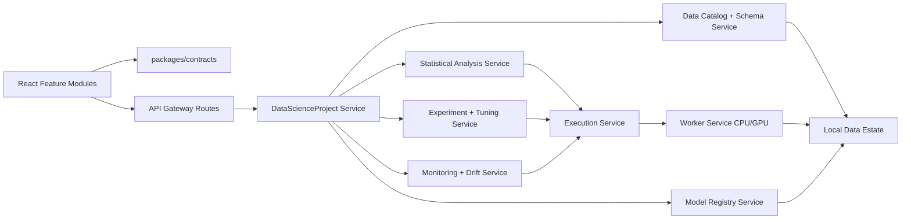

# Persona-Driven Architecture Review

Date: 2026-06-21

## Scope

This review evaluates whether the current JuliaFlow architecture can support the daily workflows identified in `docs/data-scientist-persona-competition-readiness-report.md`:

- senior data engineer
- principal data scientist
- MLOps engineer focused on model training, drift, and evaluation
- non-coding user with statistics and ML knowledge

Review mode: adversarial architecture review using ISO 42010 concerns/views, SEI ATAM risk analysis, ISO 25010 product qualities, NIST AI RMF data/ML risk, NIST SSDF secure development, and bounded local-first execution concerns.

## System Of Interest

JuliaFlow is currently organized around:

- `apps/frontend/`: React/Vite product shell and route views.
- `packages/contracts/`: TypeScript contracts, OpenAPI, workflow schema, JSON-RPC protocol.
- `services/api-gateway/`: Julia HTTP gateway, local appliance health, repository payload mapping, product actions.
- `services/execution-service/`: Julia workflow parsing, validation, planning, execution lifecycle.
- `services/worker-service/`: Julia worker runtime lanes.
- `services/node-sdk/` and `extensions/base/`: node contract and base node pack.
- `docs/`: BRD, TODO, plan, checkpoint, risk, architecture, and persona artifacts.

The existing architecture is contract-first and local-first, which is the right baseline. The gap is that persona workflows now require a first-class data/ML project architecture, not only route-specific product evidence.

## Gate Decision

Decision: pass with conditions for continued planning, block for implementation claims of daily-workstation readiness. The follow-up principal multi-reviewer synthesis in `docs/principal-persona-readiness-review.md` escalates this to a P0 block for implementation readiness until the `DataScienceProject` substrate, gateway modularity, typed jobs, validity gates, and local trust-boundary hardening exist.

Reason: the current architecture can host the new workflows, but it needs contract and module refactoring before implementation. Adding the persona capabilities directly into existing route components or the current gateway monolith would create brittle parallel shapes and make validation/test, tuning, registry, and drift evidence inconsistent.

## Findings

### P1: No First-Class Data Science Project Aggregate

Framework anchor: ISO 42010 concern/interface gap; ATAM functional suitability risk; NIST AI RMF data/ML governance gap.

Evidence:

- `apps/frontend/src/types.ts` exposes `AppData` as separate route payload arrays: data profiles, transform runs, executions, ML experiments, model registry records, deploy packages, checkpoints, dashboard, and project files.
- `packages/contracts/src/index.ts` has useful records such as `GatewayDataImportProfile`, `GatewayTransformRunRecord`, `GatewayMlExperimentRecord`, and `GatewayModelRegistryRecord`, but no aggregate that owns dataset roles, schema overrides, validation/test strategy, statistical analyses, tuning studies, prediction exports, and monitoring baselines.
- `GatewayDataWorkflowReadiness` currently reduces modeling readiness to strings such as `targetColumn` and `trainTestSplit`.

Impact:

- Senior data engineers cannot hand off schema-valid, lineage-backed feature tables as a durable project state.
- Principal data scientists cannot carry target/id/group/time/depth roles consistently from Data to Transform to ML Studio.
- MLOps engineers cannot gate registry/deployment on validation, test, drift, and reproducibility evidence.
- Non-coding users cannot rely on guided workflows because the application has no canonical project state to validate.

Required addition:

Add a contract-first `DataScienceProject` domain model in `packages/contracts/` and OpenAPI. It should include:

- `ProjectDataset`: local source, managed artifact refs, checksum, role, split role, source trust status.
- `SchemaContract`: inferred type, selected type, semantic role, units, parse rules, type override lineage.
- `DataQualityRule` and `DataQualityResult`: null, uniqueness, range, referential, duplicate, drift, and custom rules.
- `ValidationStrategy`: random, stratified, grouped, blocked/time, depth-aware, cross-validation, final test lock.
- `StatisticalAnalysisRun`: descriptive stats, OLS, t-test, chi-square, ANOVA, Pearson, Spearman, residual diagnostics, assumption warnings.
- `FeaturePipelineRef`: transform workflow id, fit/apply semantics, train/validation/test alignment evidence.
- `TrainingPlan`, `TuningStudy`, and `TuningTrial`: model family, search space, seed, resource profile, trial metrics, best-run promotion.
- `EvaluationReport`: validation score, final test score when unlocked, segment/group metrics, confusion/residual evidence, limitations.
- `PredictionExport`: output contract, row coverage, id coverage, artifact ref, checksum.
- `ModelLifecycleRecord`: candidate, validated, approved, deployed, deprecated, archived, rollback target.
- `MonitoringBaseline` and `DriftReport`: reference dataset, current dataset, schema/data/prediction/target drift, thresholds, alerts.

### P1: Gateway Product Logic Is Becoming A Monolith

Framework anchor: ISO 25010 maintainability; ATAM modifiability risk; NIST SSDF maintainability and reviewability gap.

Evidence:

- `services/api-gateway/src/JuliaFlowApiGateway.jl` contains local appliance health, chart spec building, workspace summary, data profiling fixtures, transform run payloads, ML experiment payloads, registry payloads, deploy package payloads, backup/restore, Hub handling, auth handling, and route dispatch.
- `workspace_summary_payload` contains hard-coded package counts.
- `data_profile_fixture` and `data_import_profile_response!` generate profile evidence from fixed churn/superstore-style data rather than a separated data profile service.
- `model_registry_payload` stores registry state inside execution metadata.

Impact:

- New persona features will add many more concerns to the same file unless boundaries are created first.
- Demo/local-appliance behavior can leak into product behavior.
- Model registry, drift monitoring, data catalog, and statistical EDA cannot evolve independently.
- Test ownership becomes unclear as routes, repository state, generated charts, and business logic remain coupled.

Required refactor:

Split gateway responsibilities into internal Julia modules before implementing persona workflows:

- `LocalApplianceHealth.jl`: health, workspace summary, hardware, data-estate status.
- `ChartSpecService.jl`: Plotly-compatible chart spec builders and export metadata.
- `DataCatalogService.jl`: sources, dataset registration, profile runs, schema contracts, quality results.
- `AnalysisService.jl`: statistical EDA run records and generated chart/table evidence.
- `ExperimentService.jl`: training plans, runs, tuning studies, evaluation reports.
- `ModelRegistryService.jl`: model lifecycle records independent from execution metadata.
- `MonitoringService.jl`: drift baselines, drift reports, alerts, retraining review state.
- `GatewayRoutes.jl`: thin HTTP route dispatch and error mapping only.

Keep these modules inside `services/api-gateway/src/` initially if that is the smallest move. Do not introduce a new network service until contracts and ownership prove the need.

### P1: Training, Tuning, Evaluation, And Scoring Are Not Runtime Concepts Yet

Framework anchor: NIST AI RMF measure/manage gap; ATAM correctness risk; ISO 25010 functional suitability.

Evidence:

- `GatewayMlExperimentRunRequest` accepts `executionMode`, `datasetId`, `target`, `algorithm`, and flow variables, but it does not model task type, metric, validation strategy, tuning space, seed policy, resource budget, or output contract.
- `ml_experiment_run_response!` accepts a workflow execution and wraps explainability/model-card evidence into an experiment payload.
- `services/execution-service/src/JuliaFlowExecutionService.jl` owns generic workflow execution planning but no typed ML job stages for train, validate, tune, evaluate, score, or monitor.

Impact:

- Hyperparameter tuning cannot be validated as validation-only selection.
- CPU/GPU resource use cannot be tied to each trial or promoted model.
- Final test locks and output exports are UI intentions rather than execution constraints.
- MLOps evaluation gates cannot determine whether a model can be registered or deployed.

Required addition:

Add typed execution job specs and results:

- `StatisticalAnalysisJob`
- `TrainingJob`
- `TuningJob`
- `EvaluationJob`
- `BatchScoringJob`
- `DriftMonitoringJob`

Each job should carry dataset snapshot refs, validation strategy, transform fit/apply refs, seed, resource request, expected artifacts, generated Julia code ref, and result evidence. Worker-service scheduling can still reuse existing execution records, but job metadata must be typed and contract-backed.

### P1: Validation/Test Discipline Is Not Enforced Across Layers

Framework anchor: NIST AI RMF measurement gap; ATAM data leakage risk; ISO 25010 reliability.

Evidence:

- The persona report requires train/validation/test separation, grouped/depth-aware validation, final test locks, and aligned transforms.
- `GatewayDataWorkflowReadiness` stores `trainTestSplit` as a string.
- `DataView.tsx` allows filtering, sorting, and sampling as route-local UI state, but does not persist split definitions or enforce split-aware transformations.
- Transform run requests do not carry a persisted pipeline config or fit/apply strategy.

Impact:

- Users can accidentally tune on final test data or apply inconsistent preprocessing.
- Wellbore and time/depth projects can get misleading scores through row-random validation.
- MLOps evaluation gates cannot distinguish validation metrics from final test metrics.

Required addition:

Add a validation/test architecture slice:

- contract-backed `DatasetSplitPlan`, `SplitAssignment`, `ValidationFold`, and `FinalTestLock`
- transform `fitScope` and `applyScope` metadata
- leakage checks tied to semantic roles and temporal/depth/group fields
- execution validation that rejects tuning or deployment when final test lock or split alignment is violated
- UI labels that consistently say validation and test/evaluation, not ambiguous test/submission language

### P1: Statistical EDA Needs A Calculation Layer, Not Only Charts

Framework anchor: ISO 25010 functional suitability; NIST AI RMF validity and transparency.

Evidence:

- `GatewayDataImportProfile` has `quickPlots` and `charts`.
- `data_profile_chart_specs` generates charts from fixture quick plot values.
- `VisualizeView.tsx` has EDA sections, but statistical tests and assumptions are not contract-backed.

Impact:

- Principal data scientists cannot trust OLS, t-test, chi-square, ANOVA, Pearson, Spearman, and residual diagnostics as reproducible evidence.
- Non-coding users will see visual outputs without assumption warnings or non-causal interpretation guardrails.
- Generated reports cannot cite statistical methods, inputs, assumptions, or warnings.

Required addition:

Add a local statistical-analysis module with contracts for:

- input dataset snapshot and selected columns
- method type and parameters
- assumptions checked
- result tables
- Plotly chart specs
- warning/limitation text
- generated Julia code
- reproducibility refs

This can start as a Julia module called by gateway/execution rather than a separate process.

### P2: Frontend State Is Route-Centric Rather Than Workflow-Centric

Framework anchor: ISO 25010 usability/maintainability; ISO 42010 correspondence gap.

Evidence:

- `DataView.tsx` owns filter, sort, source label, and sampling state locally.
- `TransformView.tsx` owns node selection/settings and validation status locally.
- `MlStudioView.tsx`, `ModelsView.tsx`, and `MonitorView.tsx` each interpret experiment/model/execution evidence independently.
- `App.tsx` orchestrates loading and actions through one broad `AppData` object.

Impact:

- A user can make meaningful choices in one route that are not durable or visible in another route.
- Non-coding guided workflows cannot show progress across Data -> Transform -> ML Studio -> Models -> Monitor.
- Refactoring individual screens will not produce end-to-end data science behavior unless state ownership changes.

Required refactor:

Introduce frontend feature modules after contracts land:

- `features/data-project/`: project wizard, dataset roles, schema/type manager, quality rules.
- `features/statistical-analysis/`: EDA runs and method-specific results.
- `features/validation/`: split strategy, fold/test locks, leakage warnings.
- `features/experiments/`: training plans, tuning studies, trial table, evaluation.
- `features/model-ops/`: registry lifecycle, drift reports, deployment gates.

Move shared workflow state out of route-local `useState` into typed project actions backed by gateway contracts.

### P2: Model Registry And Drift Monitoring Are Presentation-Only

Framework anchor: NIST AI RMF manage gap; ISO 25010 reliability; ATAM operational risk.

Evidence:

- `GatewayModelRegistryRecord.status` is limited to `registered`, `candidate`, `archived`, or arbitrary strings.
- `ModelsView.tsx` shows static comparison rows and drift meters.
- `MonitorView.tsx` focuses on execution records and explainability evidence, not model health, drift reports, evaluation gates, or retraining reviews.

Impact:

- MLOps users cannot run day-to-day model operations.
- Deployments cannot be gated on evaluation and drift.
- Rollback and retraining decisions do not have durable local evidence.

Required addition:

Add registry and monitoring contracts:

- lifecycle status enum: candidate, validated, approved, deployed, deprecated, archived
- approval/evaluation gate records
- rollback target and deployment binding
- monitoring baseline, current window, drift thresholds, drift metrics, alert status
- retraining review state and local job refs

Models should render registry lifecycle. Monitor should render model operations, drift, evaluation gates, and local job health.

### P2: Local File And Connector Architecture Needs Trust-Boundary Design Before Broad Import

Framework anchor: NIST SSDF; OWASP ASVS file handling; ISO 25010 security.

Evidence:

- Data source UI already advertises local files, watched folders, DuckDB, SQLite, PostgreSQL, MySQL, USB import, and drag/drop, with unsupported sources disabled.
- `data_import_profile_response!` accepts `sourceUri` and builds local evidence, but actual broad import and connector handling are still not implemented.
- Local-first requirements prohibit cloud execution and silent fake providers.

Impact:

- Implementing import quickly could introduce path traversal, symlink, unbounded file read, credential leakage, unsafe URL import, or PII exposure risks.
- Users could confuse local connector setup with cloud sync if trust boundaries are not explicit.

Required addition:

Add a `LocalSourceAccess` architecture:

- source capability grant records for browser-selected files/folders and service-owned roots
- root confinement and symlink policy
- max file size, row, column, and sample limits
- connector credential storage policy for local databases
- unsupported/disabled states in release/local-appliance mode
- audit events for source registration, refresh, and export

### P2: Node Library Breadth Exists, But Persona Semantics Need Typed Packs

Framework anchor: ISO 42010 correspondence; ISO 25010 maintainability.

Evidence:

- `docs/node-library-roadmap.md` records 150 stable nodes including transform, profile, split, correlation, covariance, histogram, linear model trainer, confusion matrix, regression metrics, dataset lineage, and GPU capability flags.
- Persona workflows need semantic groupings such as schema diagnostics, statistical tests, validation/test management, tuning, scoring, drift, and wellbore/depth-aware transforms.

Impact:

- Existing node breadth may not map cleanly to guided workflows.
- Users may see many low-level transforms without opinionated project templates or safe defaults.

Required addition:

Create typed node packs and palette metadata:

- `data-engineering`: source registration, type override, quality rule, join diagnostics, materialization.
- `statistics`: descriptive stats, OLS, t-test, chi-square, ANOVA, Pearson, Spearman, residual diagnostics.
- `validation`: split plan, grouped split, blocked split, final test lock, leakage scan.
- `training`: baseline model, MLJ model, tuning study, evaluate, score.
- `mlops`: register, approve, deploy local, drift monitor, retrain review, rollback.
- `domain-wellbore`: depth sort, resample, lag/window, trajectory features, grouped validation, well log visualizations.

## Target Architecture

The important architectural shift is that Data, Transform, ML Studio, Models, Monitor, and Deploy should not each invent their own workflow state. They should all read and mutate a shared `DataScienceProject` aggregate through contract-backed commands.

## Recommended Refactor Sequence

1. Contract-first project substrate
   - Add `DataScienceProject`, `SchemaContract`, `ValidationStrategy`, `StatisticalAnalysisRun`, `TrainingPlan`, `TuningStudy`, `EvaluationReport`, `PredictionExport`, `ModelLifecycleRecord`, and `DriftReport` to contracts and OpenAPI.

2. Gateway module split
   - Extract chart, data catalog, analysis, experiment, registry, and monitoring helpers from `JuliaFlowApiGateway.jl` into internal modules while preserving existing endpoint behavior.

3. Data project repository
   - Add file-backed repository records first; extend PostgreSQL mode later using the existing metadata mode pattern.

4. Validation/test enforcement
   - Implement split plans, final test locks, leakage checks, and transform fit/apply metadata before tuning.

5. Statistical EDA service
   - Add descriptive stats and a first set of statistical tests with generated Julia code, assumptions, tables, and Plotly specs.

6. Training/tuning job specs
   - Add typed training and tuning jobs with trial evidence, CPU/GPU resource logs, and best-run promotion.

7. Registry/drift operations
   - Add model lifecycle gates, drift baselines/reports, retraining review state, and Monitor/Models route updates.

8. Frontend feature modules
   - Refactor route-local state into project-backed actions after the contracts and gateway modules exist.

## Verification Gates For The Architecture Refactor

- Contract validation for every new domain type and endpoint.
- Julia route/repository tests for project, schema, validation, stats, tuning, registry, and drift records.
- Frontend tests proving choices made in Data persist into Transform, ML Studio, Models, Monitor, and report/export flows.
- Browser tests for guided no-code workflow, validation/test lock behavior, tuning trial promotion, drift report state, and no blank/overlap routes.
- Release/local-appliance tests proving no fixture substitution for project, stats, tuning, registry, or drift evidence.
- Security tests for local source path confinement, symlink rejection, file-size/row limits, and connector credential redaction.
- `npm run validate:contracts`
- `npm run build`
- `node scripts/run-julia.mjs --project=. tests/julia/runtests.jl`
- `npm run validate:control-doc-sync`
- `npm run validate:brd-traceability`
- `git diff --check`

## Open Questions

1. Should `DataScienceProject` be workflow-owned, or should one project own multiple workflows and experiments?
2. Should statistical EDA run as a gateway-called Julia module first, or as an execution-service job from day one?
3. Which connector should be first after local files: DuckDB tables/views, SQLite, or PostgreSQL data source?
4. Should final test/evaluation locks be reversible by project owner only, or immutable after first model promotion?
5. Should tuning use MLJ/Optim/Optuna-compatible abstractions first, or a simple native grid/random study contract first?

## Residual Risks

- Scope risk: implementing every persona lane at once would stall. Start with the generic tabular project substrate.
- Migration risk: existing demo data and route fixtures will need adapter code while new project contracts land.
- Usability risk: contract-first architecture can still produce expert-only UI unless guided no-code defaults are designed with the contracts.
- Runtime risk: CPU/GPU scheduling evidence must be attached to jobs and trials, not only health settings.
- Data risk: validation/test leaks will remain possible until split locks and transform fit/apply semantics are enforced in execution.
